# PasTinyAsm

Say what a small DOS program should do, and get a `.COM` file that does it. It runs on a 386 in real mode.

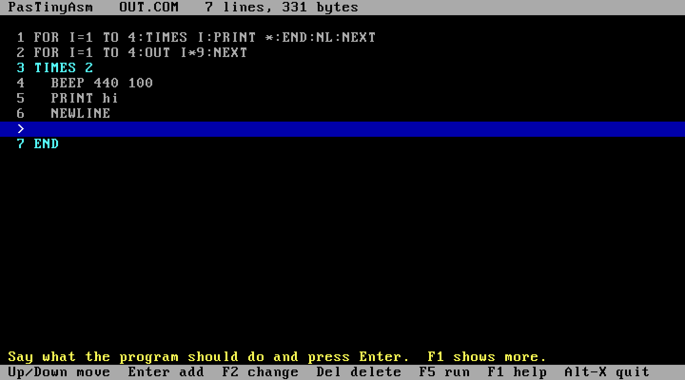

You type a sentence, the program on the screen grows by a line, and the `.COM` file is rewritten. Above: "print a triangle of stars with 4 lines", "print the first 4 multiples of 9", and a `repeat 2 times:` block with the blue typing line inside it. F5 runs it without leaving:


## In pictures

All of these are the Turbo Pascal 7 build running under DOS (DOSBox-X); see Limits for how they were captured.

| | |
|---|---|
| 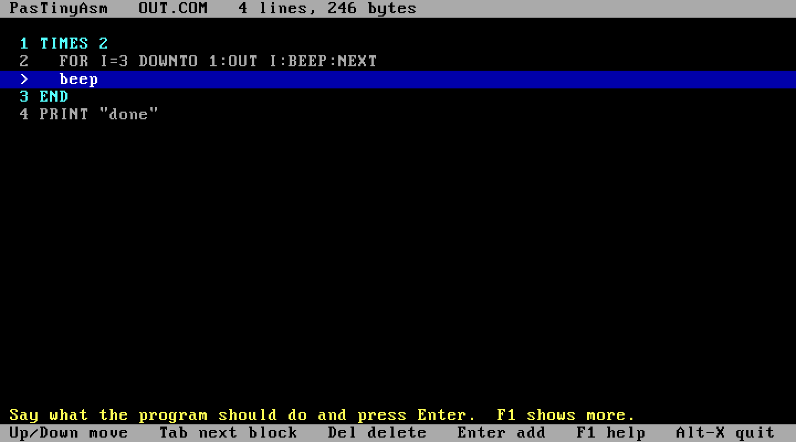 | 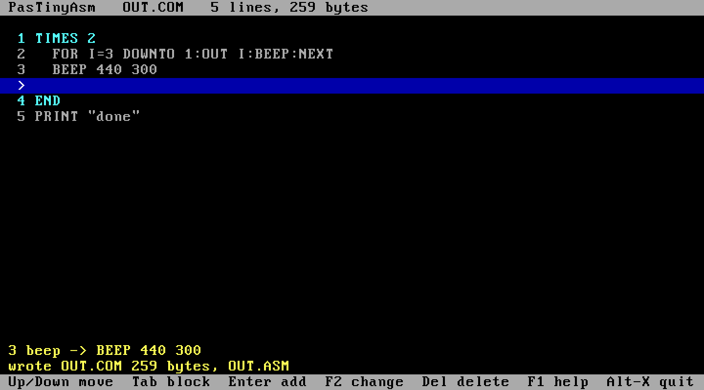 |
| **Up twice** put the blue line inside the loop; "beep" is being typed there. | **Enter** added it: the yellow lines say what the sentence became. |
| 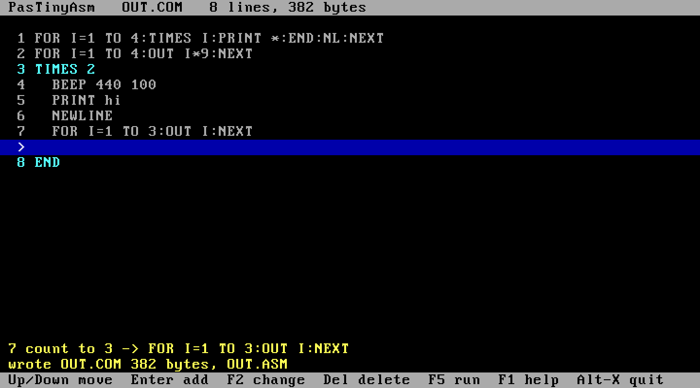 | 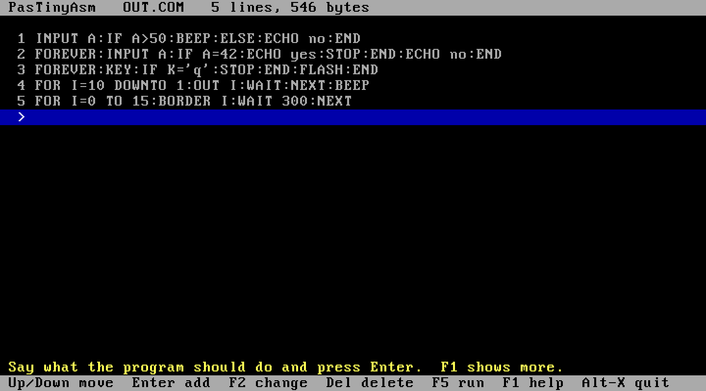 |
| "count to 3" typed inside a block became a loop of its own. | Five one-sentence programs: a test with "otherwise", ask-until, a key loop, a timer, a colour cycle. |
| 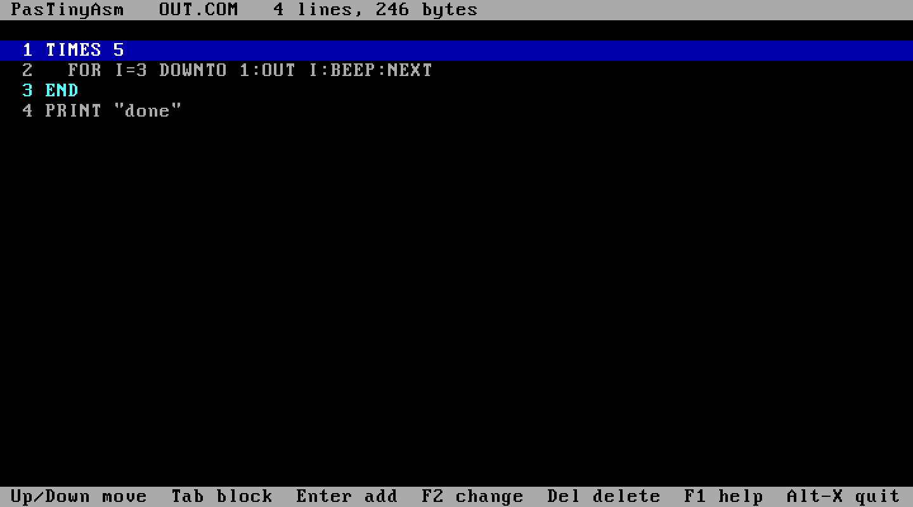 | 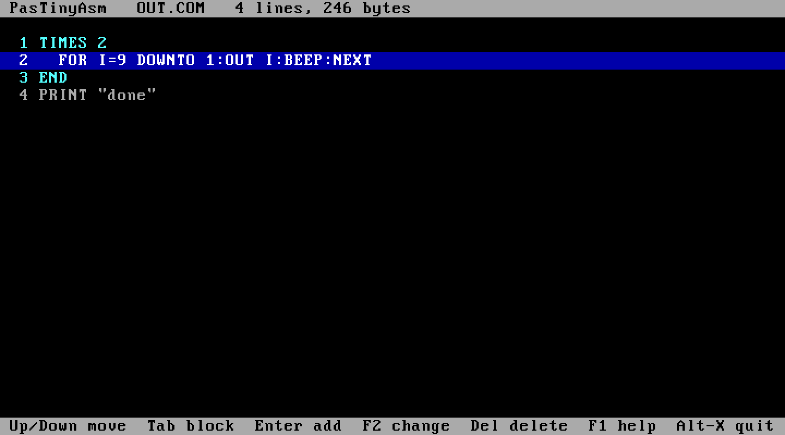 |
| **F2** takes a line up for changing, in its place. | **Left, Right, Home, End, Del** work inside the line: `I=3` became `I=9`. |
| 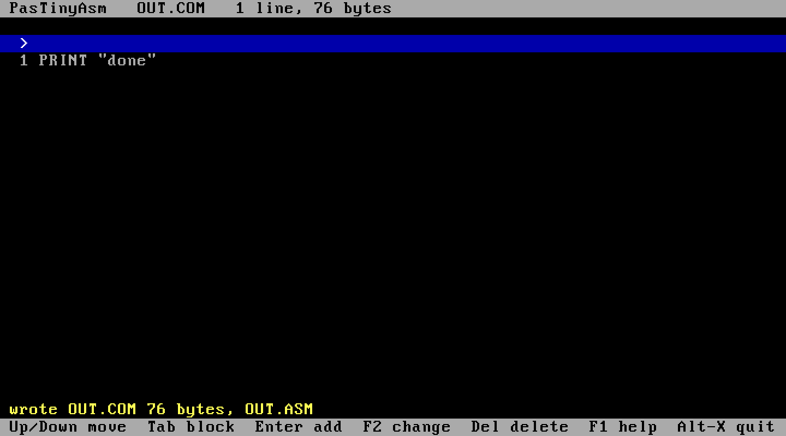 | 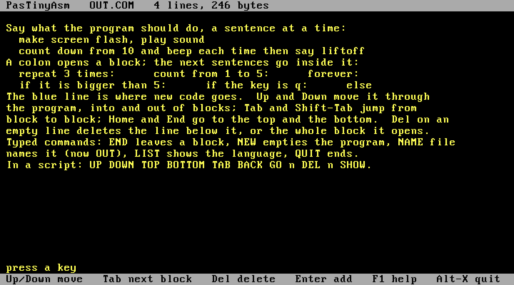 |
| **Del** on a block's first line removes the whole block. | **F1**. |

From a file, without the editor, the same thing is plain text:

```
C:\ASM> MAKECOM
> make screen flash, play sound
1 make screen flash -> FLASH 3
2 play sound -> BEEP 440 300
wrote OUT.COM 189 bytes, OUT.ASM
> count down from 5 and beep each time then say liftoff
1 count down from 5 and beep each time then say liftoff -> FOR I=5 DOWNTO 1:OUT I:BEEP:NEXT:ECHO liftoff
wrote OUT.COM 234 bytes, OUT.ASM
> quit
C:\ASM> OUT
5
4
3
2
1
liftoff
```

The models never write an instruction. A 380 KB network cannot be trusted to get machine code right, where one wrong character is a wrong program. So the work is shared:

| Step | Done by | What happens |
|---|---|---|
| Split | code | The request is cut into sentences, and those into steps at commas, "and" and "then" |
| Route | code | Each step goes to one of four experts, by its words. A sentence that asks for a loop, a question or a test goes whole to the tasks expert |
| Translate | model | The expert turns the step into one line of a small language: `FLASH 3`, or `FOR I=5 DOWNTO 1:OUT I:BEEP:NEXT` |
| Check | code | The line must compile, the numbers typed must be in it, and any text it prints must be words of the request. Otherwise it is refused, and nothing is written |
| Compile | code | All the lines become 8086 code, followed by the library routines that were used |

Five experts, each a 381,808-byte TINY 2.1 model trained from the general `TINY.BIN`:

| Expert | Writes |
|---|---|
| `SCREEN.BIN` | `CLS`, `FLASH n`, `COLOR n`, `INK n`, `BORDER n`, `GOTO row col`, `HIDE`, `SHOW` |
| `SOUND.BIN` | `BEEP hertz ms`, `SIREN n`, `SCALE`, `WAIT ms`, `KEY`, `REPEAT n` |
| `TEXT.BIN` | `PRINT text`, `NEWLINE`, `NUMBER n` |
| `TASKS.BIN` | whole small programs with loops, keyboard input, arithmetic and tests |
| `RECIPES.BIN` | the steps of a named thing, as sentences for the other four |

Two kinds of step skip the model: a step that is already a line of the language, and a step with text in double quotes, which prints that text exactly (`print "Hello, World!"`).

## Building a program in blocks

The program is built a sentence at a time, and the `.COM` file is written again after every change. Words before a colon open a block, and what you type next goes inside it.

**In the editor** (the program started at the keyboard):

| Key | What it does |
|---|---|
| typing, then Enter | adds what you typed at the blue line |
| Up, Down, PgUp, PgDn | move the blue line through the program; it takes the indent of the block it is in |
| Tab, Shift-Tab | jump to the end of the next or the previous block |
| Home, End, on an empty line | go to the top or the bottom |
| F2, or Enter on an empty line | take up the line below for changing: its code appears on the blue line, in its place; change it, or type a new sentence, and press Enter ([during](docs/editor-change.png), [after](docs/editor-changed.png)) |
| Left, Right, Home, End, Del, Backspace, Ctrl-Left, Ctrl-Right | move and correct inside what you are typing ([example](docs/editor-cursor.png)); a long line scrolls sideways |
| Del, on an empty line | delete the line below, or the whole block if that line opens one ([example](docs/editor-deleted.png)) |
| Esc | clear what you typed and leave a line unchanged; while an expert is working, cancel it |
| typing `load name` | take up the program kept in `name.SRC` |
| F5 | run the program and come back; what it left on the screen stays until a key is pressed |
| F1 | help ([screen](docs/editor-help.png)) |
| Alt-X or F10, or typing `quit` | leave |

A changed line goes through the same checks as a new one, and if it is refused the old line stays. The first line of a block can only become another first line of a block (`TIMES 2` to `TIMES 5`, or to `count from 1 to 5`); its closing line follows by itself. Closing lines and `ELSE` cannot be changed.

Every block has its closing line on the screen, so the position alone says where you are: before a block's `END` is inside it, after it is outside. The yellow lines at the bottom show what your last sentence became, or why it was refused.

`MAKECOM file` starts the editor with the lines of a file already entered.

**From a file** (`MAKECOM < file`) the same moves are typed commands, and the output is plain text:

```
> repeat 2 times:
> say hello
> count from 1 to 3:
> print the count
> end
> beep
> end
> say "done"
> show
  1 TIMES 2
  2   PRINT hello
  3   FOR X=1 TO 3
  4     OUT X
  5   NEXT
  6   BEEP 440 300
  7 END
  8 PRINT "done"
   >
```

The commands are `UP`, `DOWN`, `TOP`, `BOTTOM`, `GO n`, `TAB`, `BACK`, `END` (leave the block), `DEL`, `DEL n`, `EDIT n text` (change line n), `LOAD name`, `SAVE`, `SHOW` and `NEW`.

Blocks are opened by code, not by a model, from a small set of wordings:

| You type | Opens |
|---|---|
| `repeat 3 times:` | `TIMES 3 ... END` |
| `count from 1 to 10:`, `count down from 5:` | `FOR X=1 TO 10 ... NEXT`; nested counts use Y and Z; inside, `print the count` gives `OUT X` |
| `forever:` | `FOREVER ... END`; `stop` inside it ends the program |
| `if it is bigger than 5:` (also smaller, not, at least, at most) | `IF A>5 ... END`, about the number last asked for; `else` adds the other branch |
| `if the key is q:` (a letter, a digit, space, enter, escape) | `IF K='q' ... END`, about the key last waited for |
| any opening line of the language, such as `FOR I=1 TO 5:` | itself |

Inside a block, sentences go to the experts as usual, so one-sentence programs from the tasks expert can be nested too. A request is added whole or not at all, and a line that does not fit where it is put ("else" outside an "if") is refused.

## Recipes: say little, get a program

"build an alarm clock" names a thing and says nothing about how. A fifth expert, `RECIPES.BIN`, knows what such a thing consists of and says it in sentences the other experts understand. It is asked for one step at a time, because a whole expansion would not fit in its 128-character window:

```
> build an alarm clock
build an alarm clock:
  = ask for a number and count down from it and wait a second each time
1 ... -> INPUT A:FOR I=A DOWNTO 1:OUT I:WAIT:NEXT
  = play a siren
2 play a siren -> SIREN 2
  = flash the screen 3 times
3 flash the screen 3 times -> FLASH 3
```

Each step is then planned exactly like a sentence typed by hand, so every check on typed sentences applies, and a number in the request that does not turn up in any step refuses the whole request. A recipe is asked for with "build ...", "create ..." or "write a ... program".

It knows 30 recipes (alarm clock, kitchen timer, metronome, traffic light, doorbell, police car, SOS, rocket launch, guessing game, piano, fireworks, star tree, welcome screen and others; the list is in [`training/gen_recipes.py`](training/gen_recipes.py)), some with a number, and three changes: "N times", "with ... at the end", "on a blue screen".

**It recalls recipes; it does not adapt them.** End to end, the request alone against its steps typed by hand, 100 requests per set. Two ways of asking were tried: with the step number and the whole request, and (the one in use) with the step number, the request cut to its core and the first 20 characters of the previous step:

| Set | Same program, first way | Same program, with the previous step |
|---|---:|---:|
| Trained recipes and recipe-with-change pairs, new numbers | 96 | 100 |
| Recipe-with-change pairs held out of training | 33 | 24 |
| Names and request wordings never trained on | 21 | 36 |

- A change moves the steps: "on a blue screen" puts a new step first, so every later step has a new number. For pairs it was trained on the expert gets that right. For a recipe it has only seen without that change, it mostly loses its place: steps go missing or steps from other recipes appear.
- Giving it the previous step was meant to let it say only "what comes next". It made trained requests perfect and did nothing for held-out pairs (33 and 24 of 100 are the same result within the noise of 100 requests). So the trouble is not keeping its place; it has not learned that a change applies to every recipe.
- This is the opposite of the tasks expert, which combines parts it knows at 281 of 300. That expert writes one answer in which the parts stand side by side; here a change has to alter the answer to a different question.
- The remedy is the rule that has held everywhere else in this project: let code do the structure. Have the expert name the recipe, its number and the change, recall the plain steps, and let code wrap, prepend or append. That is not built.
- The second stage is checked only for acceptance: the steps of all 30 recipes, typed by hand, are accepted, and the recipes run under DOS printed the right things, but no test yet compares every recipe's program with what it should be.

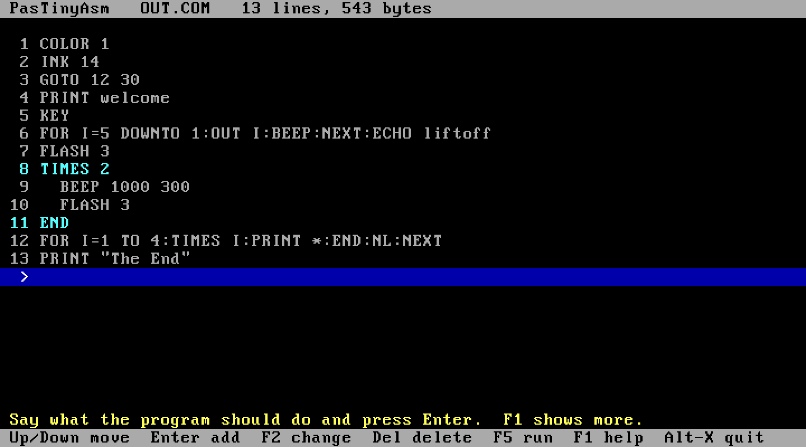

Built from "build a welcome screen", "build a rocket launch from 5", a `repeat 2 times:` block with two sentences, "print a triangle of stars with 4 lines" and `say "The End"`. Run with F5:

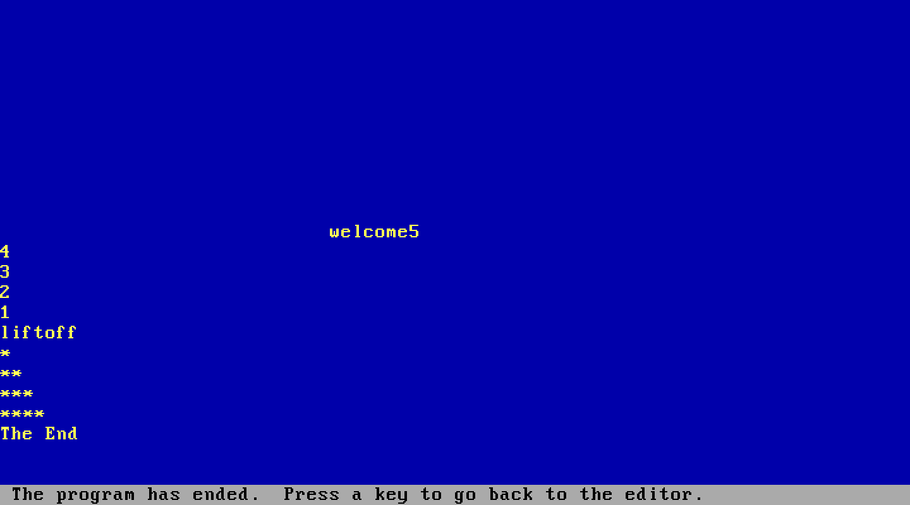

## Running, the log and extended memory

**Run and come back.** With a model loaded there is no room in 640K to start another program. So F5 (or `RUN` in a script) lets the model go, hands the memory above MAKECOM back to DOS, runs the `.COM` file, then takes the memory back and loads the model again. The program being built is not in that memory, so nothing is lost. A scripted `RUN` refuses a program that waits for the keyboard, because its input would be the rest of the script.

**The program as text.** Beside `NAME.COM` and `NAME.ASM`, every change also writes `NAME.SRC`: the program's lines as the editor shows them, one to a line. `LOAD name` in the editor or a script, or `MAKECOM name.SRC` at the DOS prompt, takes such a file up again, so quitting no longer loses the editable form. It is plain text and can be written in any editor. Its lines are code and are not put to the experts; a file with a line that is not code, a block left open, or more than 40 lines is refused and the program in hand is kept.

**As Turbo Pascal or QBasic.** `EXPORT name PAS` and `EXPORT name BAS` turn `name.SRC` into a Turbo Pascal or a QBasic program by fixed rules; no model takes part. It is a separate small program (`bin/EXPORT.EXE`, 20 KB), so it costs MAKECOM no memory.

```
FOR I=10 DOWNTO 1:OUT I:BEEP:NEXT:ECHO liftoff

for I := 10 downto 1 do begin               FOR I = 10 TO 1 STEP -1
  WriteLn(I);                                 PRINT LTRIM$(STR$(I))
  Beep(440, 300);                             CALL Tone(440, 300)
end;                                        NEXT I
WriteLn('liftoff');                         PRINT "liftoff"
```

- **The Pascal was compiled and run.** Six programs covering arithmetic, loops both ways, nested blocks, tests with `ELSE`, keyboard numbers, key loops with `STOP`, the screen calls, the sound calls and a calculator that mixes typed numbers with single keys were exported, compiled with Turbo Pascal 7 and run beside our own `.COM` files under DOS. What they printed was the same byte for byte; the colour left on the screen was the same (`1E`); the sound program took 61 clock ticks from the `.COM` and 62 from the Pascal. The sources, the exports and the comparison are in [`evidence/export/`](evidence/export/).
- **Numbers are read the way the `.COM` reads them.** The exported Pascal first used `ReadLn`, which holds a whole line back and lost input when a program also read single keys; the calculator showed it. `Ask` now reads digits with the same DOS call as the library. Text typed in quotes also keeps the spaces at its ends in the `.COM`, as it always did in the exports.
- **It is made to match.** The Pascal uses `Crt` for sound, delays and the cursor but writes through DOS, so text keeps the colours already on the screen as it does in the `.COM`; its numbers are `Word`s with checks off, cut to a `Word` where they are printed or compared, so 3 minus 5 is 65534 in both. A Pascal program is about 5 KB where the `.COM` is a few hundred bytes.
- **Turbo Pascal's `Crt` stops with runtime error 200 on a very fast machine.** That is Borland's fault, not this program's, and it happened here until the emulator was slowed to a 386's speed. On a 386 it does not arise.
- **The QBasic has not been run.** No QBasic was to hand. It is checked for form only: numbers are long integers and do not wrap at 65535, waits use the `TIMER` clock, and `SOUND` counts in clock ticks, so timings will be close and not equal.

**The log.** Every request and what became of it, refusals included, is added to `MAKECOM.LOG`. It is the place to look for wordings the experts get wrong; they are what the next training round needs.

**Extended memory.** Changing experts means loading 381,808 bytes. With an XMS driver (HIMEM.SYS) each expert's file is read from the disk once, kept above the first megabyte, and copied down each time it is wanted. `MEM` shows how often experts came from memory and from disk; `XMS OFF` goes back to the disk. Each expert kept takes 373 KB, and all of it is given back when the program ends.

## The language

The language exists because Tiny's window is 128 characters for request and answer together. Raw assembly spends that in three or four instructions; this fits a whole small program in one answer. [`TBC.PAS`](TBC.PAS) is the compiler and has the full description.

```
FOR I=10 DOWNTO 1:OUT I:BEEP:NEXT:ECHO liftoff
INPUT A:IF A>10:ECHO big:ELSE:ECHO small:END
LET S=0:FOR I=1 TO 100:LET S=S+I:NEXT:OUT S
TIMES 3:FOR I=0 TO 7:COLOR I:WAIT 300:NEXT:END
```

| Statement | Meaning |
|---|---|
| the 16 library calls | as in the table above; `BEEP`, `FLASH`, `SIREN` and `WAIT` alone mean `BEEP 440 300`, `FLASH 1`, `SIREN 1`, `WAIT 1000` |
| `OUT n`, `ECHO text` | print a number or a text, and start a new line |
| `LET v=n`, `INPUT v` | set a variable, or read a number from the keyboard |
| `FOR v=n TO n ... NEXT`, `FOR v=n DOWNTO n ... NEXT` | count up or down by one |
| `TIMES n ... END` | do the block n times |
| `FOREVER ... END`, `STOP` | loop without end; end the program |
| `IF n<n ... ELSE ... END` | tests are `=` `<>` `<` `>` `<=` `>=` |
| `REPEAT n` | on a line of its own: run the whole program n times |

`KEY` keeps the key that was pressed in K, and a character in single quotes is its code, so `IF K='q'` tests it. Variables are the letters A to Z, whole numbers from 0 to 65535. A number may be an expression with `+ - * /` and no spaces (`I*100+200`). Statements are separated by colons. A line typed whole must close the blocks it opens; a block that spans lines is opened in block mode. You can type the language yourself; nothing is asked of a model then.

Beside the `.COM` file the program writes a complete `.ASM` listing of the main part, instruction by instruction. The 17 library routines are in [`LIB.ASM`](LIB.ASM), 456 bytes of 8086 code; a program holds only the ones it uses.

## What was measured

**The compiler is exact.** For 12 programs typed in the language (every call, loops both ways, nested blocks, tests, arithmetic, input), the `.COM` file is byte for byte what NASM makes from the program's own listing plus the routines in `LIB.ASM`. 13 invalid lines are refused. Five block-mode sessions, with nesting, navigation, deleting and a refused `ELSE`, and two sessions that change lines in place (including refused changes that must leave the line alone), give the expected outlines and also match NASM.

**The tasks expert combines parts it knows in ways it has not seen.** A request is built from parts: a head (count up, count down, N times, ask for a number, test a number), actions inside it, and an action at the end. Some combinations are held out of training, though every part is trained in other combinations. Scored in the 8-bit runtime, 300 requests per set:

| Set | Right | Refused | Wrong but accepted |
|---|---:|---:|---:|
| Trained shapes and combinations, new numbers and texts | 300 | 0 | 0 |
| Held-out combinations of trained parts | 299 | 0 | 1 |
| The first version's held-out wordings, trained on since | 300 | 0 | 0 |
| Wordings never trained on | 298 | 0 | 2 |

- **Shapes.** About 60: counting with actions, `TIMES` loops, tests on a typed number with one or two actions, tables, multiples, squares, cubes, powers, sums, products, star patterns, colour cycles, tones, timers, and loops that run until a key or a number.
- **Held-out combinations** are 10 of 40 count forms with two actions, 8 of 42 action pairs in a `TIMES` loop, two actions never seen after "that many times", 9 of 42 test-and-action pairs, every "ask and count" with both an each-round and an end action, and every "if ... otherwise" with two actions. The one miss is in the last class.
- **Wordings.** The first version of this expert got 133 of 300 on wordings it had not seen, and each wording was right every time or wrong every time. Training on three to five wordings per part, in place of two or three, brought a fresh unseen set to 298. The two sets are different phrases, so this shows that variety helps, not that any wording will work.
- An earlier training round of this expert got 281 on the held-out combinations and could not write a test with two texts ("say yes if it is 7 otherwise say no") at all, because the generator never produced one. Adding that shape and the bare wording "if it is 7" brought it to the figures above.

**Second choices.** When an expert's first answer fails a check, the planner goes back to the place in that answer where the expert was least sure, takes its second choice there and lets it write on, and does the same for the next two such places. The first answer that passes every check is taken and marked `(second choice)`. One check was added to make this bite: a single call must be about something the step names, so `SHOW` needs "show", "on", "visible" or the like in the step. On the 300 unseen wordings per expert:

| Expert | Before: right / refused / wrong | With second choices | Second choices used | Of those, right |
|---|---|---|---:|---:|
| Screen | 291 / 0 / 9 | 297 / 0 / 3 | 6 | 6 |
| Sound | 207 / 20 / 73 | 259 / 41 / 0 | 55 | 55 |

"take the cursor away" now gives `HIDE`, "repeat the program 5 times" gives `REPEAT 5`, "take a break for two seconds" gives `WAIT 2000`. Trained wordings are unaffected (no second choice was needed in 1,200 of them). The word lists behind the new check are short and hand-written, which is why 21 more sound steps are refused: a refusal is the safe way to be wrong. The text and tasks experts are not helped, because their lines have no single key word to hold them to.

**The three single-call experts** (the table below includes second choices) are exact on trained wordings and unreliable on new ones. Each expert was scored in the 8-bit runtime on 300 fresh steps per set (new numbers, colours and texts every time):

| Expert | Trained wordings | First held-out set, after training on it | New held-out set: right | refused | wrong but accepted |
|---|---:|---:|---:|---:|---:|
| Screen | 300 of 300 | 300 of 300 | 297 | 0 | 3 |
| Sound | 300 of 300 | 300 of 300 | 259 | 41 | 0 |
| Text | 298 of 300 | 299 of 300 | 113 | 3 | 184 |
| All | 898 of 900 | 899 of 900 | 669 | 44 | 187 |

How this came about. The first version was trained on fixed phrases and scored 790 of 900 on a held-out set, with 108 valid calls for the wrong thing ("make the cursor invisible" gave `SHOW`). For this version those wordings went into training, the phrase lists became combinable patterns (about 4,800 distinct screen wordings where there were about 60), and a fresh held-out set was written. Every earlier failure is now right. The fresh set shows the same weakness again:

- **An expert's first answer to a wording is either always right or always wrong.** Before second choices, "take the cursor away" gave `SHOW` every time, "repeat the program 5 times" gave `SIREN 5` and "take a break for two seconds" gave a beep: 269 such answers in 900. Words the expert has never seen ("program", "break") are not understood from their meaning. Second choices and the key-word check now put most of the screen and sound ones right or refuse them.
- **The text expert's low score has one cause.** It cannot tell wrapping words it has not met from the text itself: "display the phrase hello" prints "the phrase hello", "show me hello" prints "me hello". Quotes avoid this: `display the phrase "hello"`.
- **The checks help where they apply.** The refusals are wrong calls they caught.

So more wordings make the experts right on more phrasings, but do not make them understand new ones. The plan is printed before anything runs, so a wrong call is visible. [`training/gen_asm.py`](training/gen_asm.py) holds all the wordings; `tests/test_asm.py --models --show` lists the wrong calls.

**Under DOS.** `bin/MAKECOM.EXE` is the Turbo Pascal 7 build (81,648 bytes). In DOSBox-X with an emulated FPU it ran four request files, and every program it wrote was then run. What each printed is in [`evidence/OUTPUTS.TXT`](evidence/OUTPUTS.TXT).

| Request | The program printed |
|---|---|
| count down from 5 and beep each time then say liftoff | 5 4 3 2 1 liftoff |
| ask for a number and print its double (typed 21) | 42 |
| print the 7 times table | 7 14 21 ... 70 |
| add up the numbers from 1 to 100 | 5050 |
| count down from 4 and beep each time then play a siren (a held-out combination) | 4 3 2 1 |
| ask for a number and say yes if it is 7 otherwise no (typed 7, then 3) | yes, then no |
| count from 9 to 3 | refused: the expert wrote `TO`, and that loop would not run |
| the block session shown above | hello 1 2 3 hello 1 2 3 done |
| ask for a number and print its double, then an if/else block (typed 21, then 3) | 42 big, then 6 small |
| forever: wait for a key; if the key is q: stop; say again (keys a, b, q) | again again |
| a count inside a count, edited with TOP, GO and DEL | next next next |
| a loop whose count and body were changed with EDIT | yo yo yo |

- Transcripts: [`evidence/lang/TASKS.LOG`](evidence/lang/TASKS.LOG) (sentences), [`evidence/blocks/BLOCKS.LOG`](evidence/blocks/BLOCKS.LOG) (block sessions), [`evidence/lang/LANG.LOG`](evidence/lang/LANG.LOG) (seven programs typed in the language: arithmetic, nested tests, loops ending at 0 and at 65535, zero counts), [`evidence/FPU.LOG`](evidence/FPU.LOG) (single calls).
- The earlier checks still pass: `COLOR 1` leaves `1F` in screen memory, `WAIT 2000` takes 36 clock ticks (1.98 seconds), a 12-step program using every screen call ends with the right colours.
- **The editor** cannot be driven from a file, so the emulator typed into it, starting from a four-line program: Up, Up, `beep`, Enter put `BEEP 440 300` inside the loop (the pictures above, and the listing it wrote); Home, Del removed the whole loop and left one line; Home, F2, Backspace, `5`, Enter changed `TIMES 2` to `TIMES 5` in place; on line 2, F2, Home, Right six times, Del, `9`, Enter changed `FOR I=3` to `FOR I=9` in the middle of the line; typing `bep`, Left, `e`, Home, `x`, Del, End, Backspace, `p` left `xeep`, as it should; F1 showed the help page. That is all that was tried: Tab, PgUp, PgDn, Ctrl-Left and Ctrl-Right, sideways scrolling of a long line, scrolling of a long program and Esc during an expert's work were not.
- On an emulated 386 without an FPU, a countdown request and a block gave a program that printed 3 2 1 liftoff hi hi ([`evidence/NOFPU.LOG`](evidence/NOFPU.LOG)).

## Limits

- The pictures in `docs/` are not photographs of a monitor. DOSBox-X's window stayed black on the virtual display used here, so a helper saved the text screen and the BIOS font from inside the emulator and `tools/screenshot.py` drew them. The editor saves its own screen when F9 is pressed, which is how its pictures were taken; after F5 that screen is a copy of what the program left in screen memory. The emulator's typing command could not type a colon, so the pictures start from a program loaded with `MAKECOM file`.
- The flash and the sounds were not seen or heard: DOSBox-X ran without a display or sound device. What was checked is that the programs finish, take the right time and leave the right colours in screen memory. Nothing was run on real hardware.
- The screen routines write to colour text memory at `B800:0000` and assume 80 by 25. Delays use BIOS interrupt 15h function 86h (AT-class machines).
- Text without quotes is small letters and digits only, and a text with "and" or "then" in it is split into two steps. Use quotes.
- A step holds 72 characters, a line 120, and a program 40 lines, 4,096 bytes and 24 texts.
- The numbers check only looks at numbers typed as digits. "beep for five seconds" is not checked against the 5.
- The package no longer fits one floppy: with five experts and the exporter it unpacks to 2,015,502 bytes. Without `TASKS.BIN` (and with a three-entry catalog) the program still runs, at about 1.2 MB, which does fit.
- The tasks expert knows about 30 program shapes. A request outside them gets a wrong line or a refusal; it does not reason about new logic.
- Variables are unsigned 16-bit; arithmetic wraps, and dividing by zero ends the program with the DOS divide message.
- The program needs about 590 KB of free conventional memory, and 2,320 bytes of heap remain with a model loaded; the stack was raised to 20 KB for the recipe path. Its copies of the engine units are cut to the one model shape it uses and to 8 catalog entries, which is where the room came from.
- Block openers are a fixed set of wordings read by code. Without the colon, "repeat 3 times" still means the whole program.
- The editor shows the code, not your sentences, so a line taken up for changing shows its code. The cursor moves inside the line being typed, but typing always inserts; there is no overwrite mode. It assumes an 80 by 25 text screen.
- One run of the typed change test stalled in the emulator and three repeats of the same keys did not; I could not find a cause in the program.
- The router is a word list in `MAKECOM.PAS`, not a model.
- `bin/MAKECOM.EXE` was built with a Turbo Pascal 7 copy whose runtime differs slightly from the one used for the other executables in this repository.
- One training run per expert and version; the scores above are from those runs.
- The new held-out set was written by the same author as the training wordings, so it is easier than what a stranger would type.

## Build, test, train

```
python3 tools/buildlib.py                     LIB.ASM -> LIB.INC (needs NASM)
fpc -Mtp -B MAKECOM.PAS                       host build for testing
python3 tests/test_asm.py ./MAKECOM           compiler against NASM
python3 tests/test_asm.py ./MAKECOM --models  plans, refusals and expert scores
TPC /B MAKECOM.PAS                            the DOS program (BUILD.BAT)
TPC /B EXPORT.PAS                             the exporter
```

To retrain an expert (PyTorch, 35 to 55 minutes on one CPU core), then rewrite the catalog:

```
python3 training/train_asm.py screen ../PasTinyMoE/TINY.BIN SCREEN.BIN 6000
THREADS=4 python3 training/train_asm.py tasks ../PasTinyMoE/TINY.BIN TASKS.BIN 8000
python3 tools/package.py
```

To add a routine: write it in `LIB.ASM` with its `;;` header line, run `tools/buildlib.py`, add wordings for it to `training/gen_asm.py` and words for it to the router in `MAKECOM.PAS`, and retrain that expert.

The task shapes and their held-out combinations are in [`training/gen_tasks.py`](training/gen_tasks.py).

`TNYNET.PAS`, `TNYSYS.PAS` and `EXPCAT.PAS` are copies of the PasTinyMoE engine units. `tests/attr.asm`, `tests/ticks.asm` and `tests/snap.asm` are the helper programs used for the DOS checks and the pictures.
