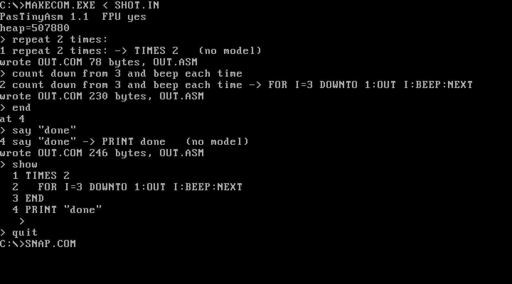

# PasTinyAsm

Say what a small DOS program should do, and get a `.COM` file that does it. It runs on a 386 in real mode.

```
C:\ASM> MAKECOM
> make screen flash, play sound
1 make screen flash -> FLASH 3
2 play sound -> BEEP 440 300
wrote OUT.COM 189 bytes, OUT.ASM
> count down from 5 and beep each time then say liftoff
1 count down from 5 and beep each time then say liftoff -> FOR I=5 DOWNTO 1:OUT I:BEEP:NEXT:ECHO liftoff
wrote OUT.COM 234 bytes, OUT.ASM
> quit
C:\ASM> OUT
5
4
3
2
1
liftoff
```



The DOS text screen after a block session (input fed from a file, which the program echoes as `> ...`). The picture is drawn from the screen memory and font saved inside the emulator by [`tests/snap.asm`](tests/snap.asm); see Limits.

The models never write an instruction. A 380 KB network cannot be trusted to get machine code right, where one wrong character is a wrong program. So the work is shared:

| Step | Done by | What happens |
|---|---|---|
| Split | code | The request is cut into sentences, and those into steps at commas, "and" and "then" |
| Route | code | Each step goes to one of four experts, by its words. A sentence that asks for a loop, a question or a test goes whole to the tasks expert |
| Translate | model | The expert turns the step into one line of a small language: `FLASH 3`, or `FOR I=5 DOWNTO 1:OUT I:BEEP:NEXT` |
| Check | code | The line must compile, the numbers typed must be in it, and any text it prints must be words of the request. Otherwise it is refused, and nothing is written |
| Compile | code | All the lines become 8086 code, followed by the library routines that were used |

Four experts, each a 381,808-byte TINY 2.1 model trained from the general `TINY.BIN`:

| Expert | Writes |
|---|---|
| `SCREEN.BIN` | `CLS`, `FLASH n`, `COLOR n`, `INK n`, `BORDER n`, `GOTO row col`, `HIDE`, `SHOW` |
| `SOUND.BIN` | `BEEP hertz ms`, `SIREN n`, `SCALE`, `WAIT ms`, `KEY`, `REPEAT n` |
| `TEXT.BIN` | `PRINT text`, `NEWLINE`, `NUMBER n` |
| `TASKS.BIN` | whole small programs with loops, keyboard input, arithmetic and tests |

Two kinds of step skip the model: a step that is already a line of the language, and a step with text in double quotes, which prints that text exactly (`print "Hello, World!"`).

## Building a program in blocks

The program is built up over a session, a sentence at a time, and the `.COM` file is written again after every change. Words before a colon open a block, and what you type next goes inside it:

```
> repeat 2 times:
> say hello
> count from 1 to 3:
> print the count
> end
> beep
> end
> say "done"
> show
  1 TIMES 2
  2   PRINT hello
  3   FOR X=1 TO 3
  4     OUT X
  5   NEXT
  6   BEEP 440 300
  7 END
  8 PRINT "done"
   >
```

The `>` in the listing is where the next line will go. Every block has its closing line, so the place alone says whether you are inside a block (before its `END`) or after it.

| Key | Typed command | What it does |
|---|---|---|
| Up, Down | `UP`, `DOWN` | move the place one line |
| Home, End | `TOP`, `BOTTOM`, `GO n` | move to the start, the end, or before line n |
| Tab, Shift-Tab | `TAB`, `BACK` | jump to the end of the next or the previous block |
| | `END` | leave the block you are in |
| Del | `DEL`, `DEL n` | delete a line, or the whole block if it is the block's first line |
| | `SHOW`, `NEW` | list the program, or empty it |

The keys work on an empty input line. Blocks are opened by code, not by a model, from a small set of wordings:

| You type | Opens |
|---|---|
| `repeat 3 times:` | `TIMES 3 ... END` |
| `count from 1 to 10:`, `count down from 5:` | `FOR X=1 TO 10 ... NEXT`; nested counts use Y and Z; inside, `print the count` gives `OUT X` |
| `forever:` | `FOREVER ... END`; `stop` inside it ends the program |
| `if it is bigger than 5:` (also smaller, not, at least, at most) | `IF A>5 ... END`, about the number last asked for; `else` adds the other branch |
| `if the key is q:` (a letter, a digit, space, enter, escape) | `IF K='q' ... END`, about the key last waited for |
| any opening line of the language, such as `FOR I=1 TO 5:` | itself |

Inside a block, sentences go to the experts as usual, so one-sentence programs from the tasks expert can be nested too. A request is added whole or not at all, and a line that does not fit where it is put ("else" outside an "if") is refused.

## The language

The language exists because Tiny's window is 128 characters for request and answer together. Raw assembly spends that in three or four instructions; this fits a whole small program in one answer. [`TBC.PAS`](TBC.PAS) is the compiler and has the full description.

```
FOR I=10 DOWNTO 1:OUT I:BEEP:NEXT:ECHO liftoff
INPUT A:IF A>10:ECHO big:ELSE:ECHO small:END
LET S=0:FOR I=1 TO 100:LET S=S+I:NEXT:OUT S
TIMES 3:FOR I=0 TO 7:COLOR I:WAIT 300:NEXT:END
```

| Statement | Meaning |
|---|---|
| the 16 library calls | as in the table above; `BEEP`, `FLASH`, `SIREN` and `WAIT` alone mean `BEEP 440 300`, `FLASH 1`, `SIREN 1`, `WAIT 1000` |
| `OUT n`, `ECHO text` | print a number or a text, and start a new line |
| `LET v=n`, `INPUT v` | set a variable, or read a number from the keyboard |
| `FOR v=n TO n ... NEXT`, `FOR v=n DOWNTO n ... NEXT` | count up or down by one |
| `TIMES n ... END` | do the block n times |
| `FOREVER ... END`, `STOP` | loop without end; end the program |
| `IF n<n ... ELSE ... END` | tests are `=` `<>` `<` `>` `<=` `>=` |
| `REPEAT n` | on a line of its own: run the whole program n times |

`KEY` keeps the key that was pressed in K, and a character in single quotes is its code, so `IF K='q'` tests it. Variables are the letters A to Z, whole numbers from 0 to 65535. A number may be an expression with `+ - * /` and no spaces (`I*100+200`). Statements are separated by colons. A line typed whole must close the blocks it opens; a block that spans lines is opened in block mode. You can type the language yourself; nothing is asked of a model then.

Beside the `.COM` file the program writes a complete `.ASM` listing of the main part, instruction by instruction. The 17 library routines are in [`LIB.ASM`](LIB.ASM), 456 bytes of 8086 code; a program holds only the ones it uses.

## What was measured

**The compiler is exact.** For 12 programs typed in the language (every call, loops both ways, nested blocks, tests, arithmetic, input), the `.COM` file is byte for byte what NASM makes from the program's own listing plus the routines in `LIB.ASM`. 13 invalid lines are refused. Five block-mode sessions, with nesting, navigation, deleting and a refused `ELSE`, give the expected outlines and also match NASM.

**The tasks expert combines parts it knows in ways it has not seen.** This was the experiment. A request is built from parts: a head (count up, count down, N times, ask for a number), an optional action in each round, and an optional action at the end. Some combinations were held out of training, though every part was trained in other combinations. Scored in the 8-bit runtime, 300 requests per set:

| Set | Right | Refused | Wrong but accepted |
|---|---:|---:|---:|
| Trained combinations, new numbers and texts | 300 | 0 | 0 |
| Held-out combinations of trained parts | 299 | 0 | 1 |
| New wordings of the heads | 133 | 79 | 88 |

- **Held-out combinations:** 10 of the 40 count-with-two-actions forms, 8 of the 42 two-action pairs in a `TIMES` loop, two actions never seen after "that many times", and every "ask for a number and count" with both an each-round and an end action. The one miss wrote `SIREN` where `SCALE` was wanted.
- **New wordings are the same weakness as before, and all-or-nothing.** "show every number from 3 to 9" and "ask the user for a number" were right every time (106 of 106). "in each of 5 rounds ..." was wrong every time (0 of 101). "count from 9 back to 3" mostly came out counting up; the compiler refuses a loop whose plain numbers run the wrong way, which turned 66 of those into refusals.

So within the shapes it was trained on, the expert does compose. It does not understand words it has not met.

**The three single-call experts** are exact on trained wordings and unreliable on new ones. Each expert was scored in the 8-bit runtime on 300 fresh steps per set (new numbers, colours and texts every time):

| Expert | Trained wordings | First held-out set, after training on it | New held-out set: right | refused | wrong but accepted |
|---|---:|---:|---:|---:|---:|
| Screen | 300 of 300 | 300 of 300 | 291 | 0 | 9 |
| Sound | 300 of 300 | 300 of 300 | 207 | 20 | 73 |
| Text | 299 of 300 | 300 of 300 | 113 | 0 | 187 |
| All | 899 of 900 | 900 of 900 | 611 | 20 | 269 |

How this came about. The first version was trained on fixed phrases and scored 790 of 900 on a held-out set, with 108 valid calls for the wrong thing ("make the cursor invisible" gave `SHOW`). For this version those wordings went into training, the phrase lists became combinable patterns (about 4,800 distinct screen wordings where there were about 60), and a fresh held-out set was written. Every earlier failure is now right. The fresh set shows the same weakness again:

- **A wording is either always right or always wrong.** "take the cursor away" gives `SHOW` every time; "repeat the program 5 times" gives `SIREN 5` every time; "take a break for two seconds" gives a beep. Words the expert has never seen ("program", "break") are not understood from their meaning.
- **The text expert's low score has one cause.** It cannot tell wrapping words it has not met from the text itself: "display the phrase hello" prints "the phrase hello", "show me hello" prints "me hello". Quotes avoid this: `display the phrase "hello"`.
- **The numbers check helps where it applies.** The 20 refusals are wrong calls it caught.

So more wordings make the experts right on more phrasings, but do not make them understand new ones. The plan is printed before anything runs, so a wrong call is visible. [`training/gen_asm.py`](training/gen_asm.py) holds all the wordings; `tests/test_asm.py --models --show` lists the wrong calls.

**Under DOS.** `bin/MAKECOM.EXE` is the Turbo Pascal 7 build (60,640 bytes). In DOSBox-X with an emulated FPU it ran four request files, and every program it wrote was then run. What each printed is in [`evidence/OUTPUTS.TXT`](evidence/OUTPUTS.TXT).

| Request | The program printed |
|---|---|
| count down from 5 and beep each time then say liftoff | 5 4 3 2 1 liftoff |
| ask for a number and print its double (typed 21) | 42 |
| print the 7 times table | 7 14 21 ... 70 |
| add up the numbers from 1 to 100 | 5050 |
| count down from 4 and beep each time then play a siren (a held-out combination) | 4 3 2 1 |
| ask for a number and say yes if it is 7 otherwise no (typed 7, then 3) | yes, then no |
| count from 9 to 3 | refused: the expert wrote `TO`, and that loop would not run |
| the block session shown above | hello 1 2 3 hello 1 2 3 done |
| ask for a number and print its double, then an if/else block (typed 21, then 3) | 42 big, then 6 small |
| forever: wait for a key; if the key is q: stop; say again (keys a, b, q) | again again |
| a count inside a count, edited with TOP, GO and DEL | next next next |

- Transcripts: [`evidence/lang/TASKS.LOG`](evidence/lang/TASKS.LOG) (sentences), [`evidence/blocks/BLOCKS.LOG`](evidence/blocks/BLOCKS.LOG) (block sessions), [`evidence/lang/LANG.LOG`](evidence/lang/LANG.LOG) (seven programs typed in the language: arithmetic, nested tests, loops ending at 0 and at 65535, zero counts), [`evidence/FPU.LOG`](evidence/FPU.LOG) (single calls).
- The earlier checks still pass: `COLOR 1` leaves `1F` in screen memory, `WAIT 2000` takes 36 clock ticks (1.98 seconds), a 12-step program using every screen call ends with the right colours.
- **Keys.** The arrow keys cannot be fed from a file, so they were typed into the running program by the emulator: `cls`, `hide`, Up, `key` gave CLS, KEY, HIDE ([screen](docs/keys.png)), and with Tab in place of Up gave CLS, HIDE, KEY.
- On an emulated 386 without an FPU, a countdown request and a block gave a program that printed 3 2 1 liftoff hi hi ([`evidence/NOFPU.LOG`](evidence/NOFPU.LOG)).

## Limits

- The pictures in `docs/` are not photographs of a monitor. DOSBox-X's window stayed black on the virtual display used here, so a helper saved the text screen and the BIOS font from inside the emulator and `tools/screenshot.py` drew them. The emulator's own typing command could not type a colon, so the block session in the first picture was fed from a file; the second picture was typed.
- The flash and the sounds were not seen or heard: DOSBox-X ran without a display or sound device. What was checked is that the programs finish, take the right time and leave the right colours in screen memory. Nothing was run on real hardware.
- The screen routines write to colour text memory at `B800:0000` and assume 80 by 25. Delays use BIOS interrupt 15h function 86h (AT-class machines).
- Text without quotes is small letters and digits only, and a text with "and" or "then" in it is split into two steps. Use quotes.
- A step holds 72 characters, a line 120, and a program 40 lines, 4,096 bytes and 24 texts.
- The numbers check only looks at numbers typed as digits. "beep for five seconds" is not checked against the 5.
- The package no longer fits one floppy: with four experts it unpacks to 1,590,994 bytes. Without `TASKS.BIN` (and with a three-entry catalog) the program still runs, at about 1.2 MB, which does fit.
- The tasks expert knows about 30 program shapes. A request outside them gets a wrong line or a refusal; it does not reason about new logic.
- Variables are unsigned 16-bit; arithmetic wraps, and dividing by zero ends the program with the DOS divide message.
- The program needs about 590 KB of free conventional memory, and 23,680 bytes of heap remain with a model loaded. Its copies of the engine units are cut to the one model shape it uses and to 8 catalog entries, which is where the room came from.
- There is no RUN command: with the model in memory there is no room to start another program. Quit, then run the `.COM` file.
- Block openers are a fixed set of wordings read by code. Without the colon, "repeat 3 times" still means the whole program.
- The outline shows the code, not your sentences, and is not a full-screen editor: it is printed again after each change.
- The router is a word list in `MAKECOM.PAS`, not a model.
- `bin/MAKECOM.EXE` was built with a Turbo Pascal 7 copy whose runtime differs slightly from the one used for the other executables in this repository.
- One training run per expert and version; the scores above are from those runs.
- The new held-out set was written by the same author as the training wordings, so it is easier than what a stranger would type.

## Build, test, train

```
python3 tools/buildlib.py                     LIB.ASM -> LIB.INC (needs NASM)
fpc -Mtp -B MAKECOM.PAS                       host build for testing
python3 tests/test_asm.py ./MAKECOM           compiler against NASM
python3 tests/test_asm.py ./MAKECOM --models  plans, refusals and expert scores
TPC /B MAKECOM.PAS                            the DOS program (BUILD.BAT)
```

To retrain an expert (PyTorch, 35 to 55 minutes on one CPU core), then rewrite the catalog:

```
python3 training/train_asm.py screen ../PasTinyMoE/TINY.BIN SCREEN.BIN 6000
THREADS=4 python3 training/train_asm.py tasks ../PasTinyMoE/TINY.BIN TASKS.BIN 8000
python3 tools/package.py
```

To add a routine: write it in `LIB.ASM` with its `;;` header line, run `tools/buildlib.py`, add wordings for it to `training/gen_asm.py` and words for it to the router in `MAKECOM.PAS`, and retrain that expert.

The task shapes and their held-out combinations are in [`training/gen_tasks.py`](training/gen_tasks.py).

`TNYNET.PAS`, `TNYSYS.PAS` and `EXPCAT.PAS` are copies of the PasTinyMoE engine units. `tests/attr.asm`, `tests/ticks.asm` and `tests/snap.asm` are the helper programs used for the DOS checks and the pictures.
