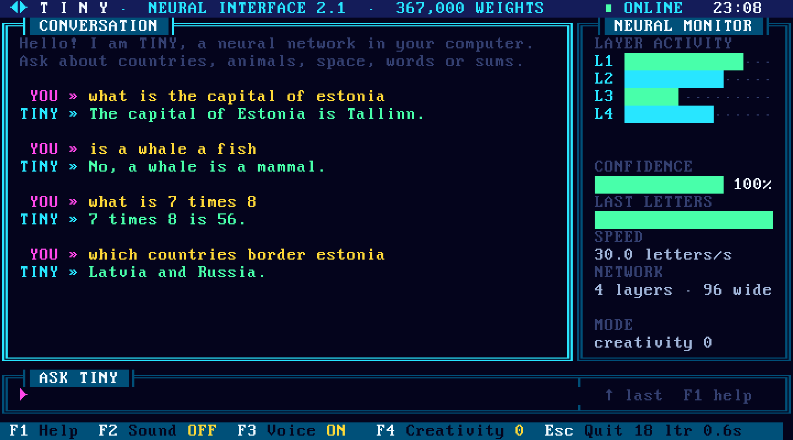
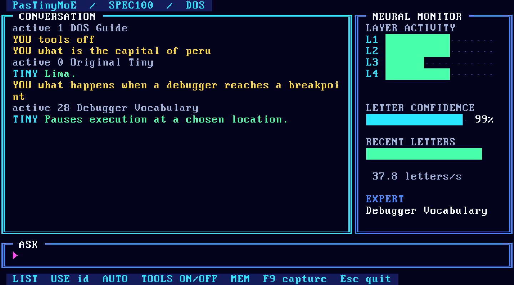
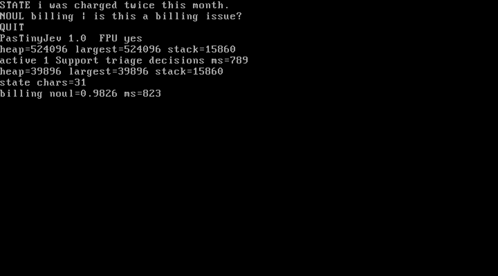
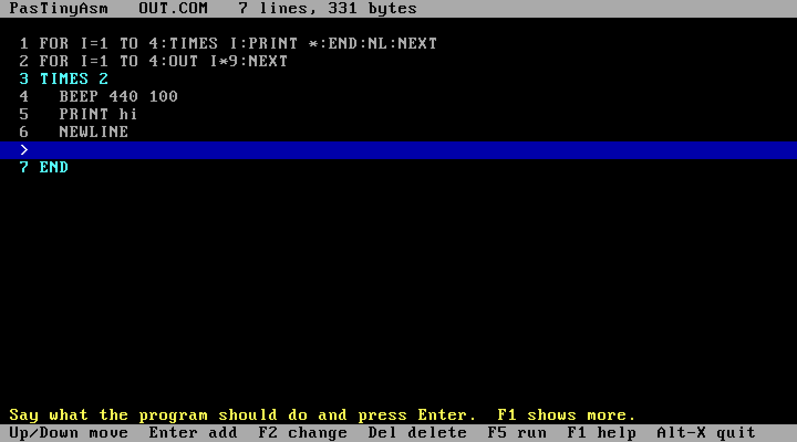
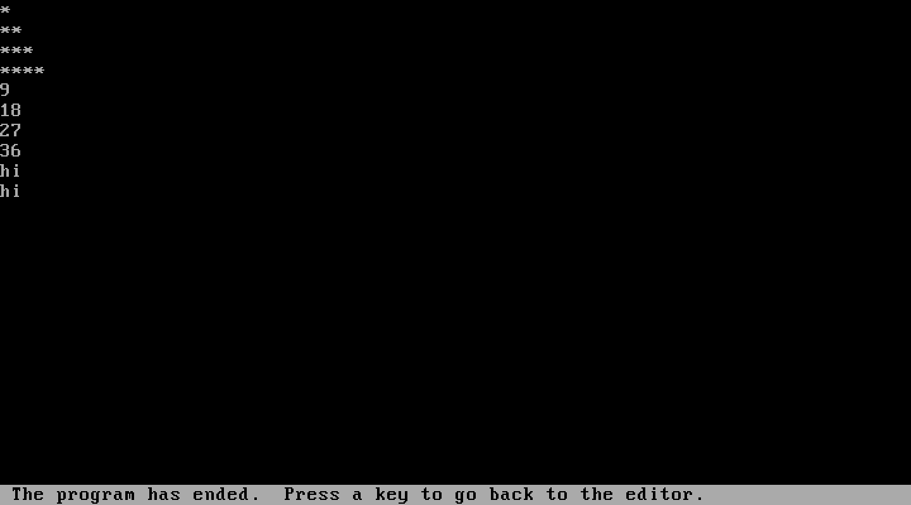
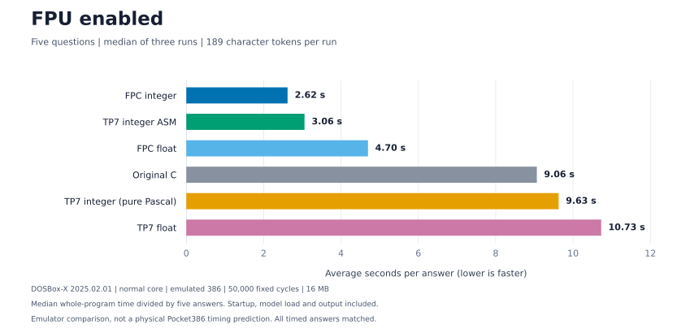
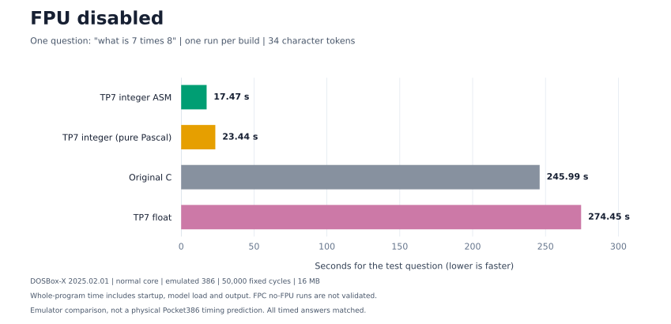

# PasTiny

A Pascal port of [TINY 2.1](https://github.com/WollyMonjac/Tiny-2.1), a small character-level question-answering transformer for DOS.

- Default integer inference engine; original float engine with `FLOATMATH`.
- DOS neon interface, neural monitor, PC-speaker voice, and plain text mode.
- Free Pascal native host and 32-bit DOS builds; TP7/BP7 build commands supplied.
- Unchanged upstream model and reference implementation retained for comparisons.

## Project guide

| Project | Where it runs | What to try |
| --- | --- | --- |
| [PasTiny](#run-on-dos) | 386 DOS or native Linux | Ask the original Tiny model a question. The DOS edition has a neon text interface, a live neural monitor and PC-speaker chatter. Start with [TP7TINY.ZIP](dist/TP7TINY.ZIP) for a 386 without a coprocessor. |
| [Delphi 1 edition](delphi1/README.TXT) | Windows 3.1 | Run the same model in an 80×25 Win16 chat window with the monitor and voice. |
| [Modern Pascal editions](delphi13/README.md) | Delphi 13 or Free Pascal | Run `TinyConsole` for terminal chat, build `TinyChat` for Windows VCL, or open `TinyChatFMX` for the FireMonkey interface with PasClaw’s dark theme. |
| [PasTinyMoE](PasTinyMoE/README.md) | 386 DOS | Ask a question in `AUTO` to route it among 100 specialists, with original Tiny as the fallback. Use `LIST` and `USE` to pick one yourself. [SPEC100.ZIP](PasTinyMoE/dist/SPEC100.ZIP) |
| [PasTinyJev](PasTinyJev/README.md) | 386 DOS | Give the support-triage model a message and ask for a yes/no probability, a choice or a score. The edition fits on a [1.44 MB floppy image](PasTinyJev/dist/JEV1.IMG). |
| [PasTinyAsm](PasTinyAsm/README.md) | 386 DOS | Describe a small DOS program one instruction at a time, edit the generated program and press F5 to run the resulting `.COM` file. [PASASM.ZIP](PasTinyAsm/dist/PASASM.ZIP) |
| [Hand-written networks](PasTinyMoE/handwritten/README.md) | PasTinyMoE and PasTinyJev runtimes | Explore weights that implement algorithms directly, including word reversal, ROT13, number comparison and addition. |

### Screenshots from DOSBox-X



PasTiny’s Turbo Pascal 7 DOS build, captured from the VGA text buffer with its neon palette.

| PasTinyMoE routes two questions | PasTinyJev scores a billing message |
| --- | --- |
| [](docs/screenshots/moe-neon.png) | [](docs/screenshots/jev.png) |

| PasTinyAsm editor | Running the program with F5 |
| --- | --- |
| [](PasTinyAsm/docs/editor-shapes.png) | [](PasTinyAsm/docs/editor-run.png) |

## Run on DOS

For a 386 without a coprocessor, use **[TP7TINY.ZIP](https://github.com/FMXExpress/PasTiny/raw/refs/heads/main/dist/TP7TINY.ZIP)**: the Turbo Pascal 7 real-mode build with built-in floating-point emulation. It has passed all 60 reference answers with the FPU enabled, plus the five-question benchmark with `fpu=false`. Physical Pocket386 hardware remains untested. No CWSDPMI or WMEMU387 file is needed for this build.

For the Free Pascal 32-bit DOS build, download [TINYPAS.ZIP](https://github.com/FMXExpress/PasTiny/raw/refs/heads/main/dist/TINYPAS.ZIP) and extract it into a DOS directory. The archive is flat and **every entry uses uppercase 8.3 filenames**. It includes the Pascal integer and float executables, unchanged model, runtime files, Pascal source, and build commands.

```dos
TINY 0
TINY 0 /P
TINY /BENCH > BENCH.TXT
```

Keep `TINY.BIN` in the working directory and `CWSDPMI.EXE` beside the DOS executable. `WMEMU387.DXE` is included for the linked Free Pascal emulator support. **FPC no-FPU operation and physical Pocket386 acceptance remain unverified**; see the test limitations below.

The repository root `TINY.EXE` is the original Turbo C reference executable. The new Pascal builds are [`BIN/DOS/TINY.EXE`](BIN/DOS/TINY.EXE) (integer) and [`BIN/DOS/TNYFLT.EXE`](BIN/DOS/TNYFLT.EXE) (float). `TINYPAS.ZIP` contains only the Pascal executables.

## Build and test on Linux

Install Free Pascal 3.2.2, GCC, Make, and Python 3:

```sh
make host
make test
./build/int/TINY 0 /P
./build/int/TINY /BENCH
```

A static x86-64 Linux build and model are also included in `BIN/LINUX`.

For native Free Pascal DOS builds, run `BUILDFPC.BAT`; for a configured go32v2 cross compiler, use `make go32v2` and `make go32v2-float`. The CPU flag is `-Cp80386`.

`BUILD.BAT` supplies Turbo Pascal 7 and Borland Pascal 7 real-mode and BP7 protected-mode commands. Keep `TNYUI.INC` with the Pascal units. Turbo Pascal 7 real mode is now verified; BP7 protected mode remains unverified. To reproduce the TP7 checks with your own compiler files:

```sh
TP7_DIR=/path/to/compiler/bin make test-tp7
```

## Validation and benchmarks

Both Pascal engines match **60/60 reference answers on Linux and DOSBox-X**. The actual Borland Turbo Pascal 7 real-mode integer and float builds also match 60/60; the classic integer ASM and NOASM variants are compared separately. Debug and NOASM host builds pass; malformed model errors match C. Screen dump comparisons pass outside the documented clock/speed/version cells, and 279 deterministic sound events match.

DOSBox-X 2025.02.01, normal core, emulated 386, **50,000 fixed cycles**, 16 MB. Every executable runs in plain mode with the same input within each comparison. A shared external timer measures the complete process, including startup, model loading, and output. All timed runs returned the expected answers.

### FPU enabled

Five questions, 189 character tokens per run; median of three runs. Average seconds per answer is the median whole-program time divided by five.



| Version | Average seconds/answer | Tokens/second |
|---|---:|---:|
| FPC integer | 2.62 | 14.434 |
| TP7 integer ASM | 3.06 | 12.367 |
| FPC float | 4.70 | 8.046 |
| Original C | 9.06 | 4.170 |
| TP7 integer, pure Pascal | 9.63 | 3.926 |
| TP7 float | 10.73 | 3.523 |

### FPU disabled

One run per version of **“what is 7 times 8”**, 34 character tokens. This shorter workload keeps the software-float runs practical. These are seconds for that single question, not the five-question averages above.



| Version | Seconds for the test question | Tokens/second |
|---|---:|---:|
| TP7 integer ASM | 17.47 | 1.946 |
| TP7 integer, pure Pascal | 23.44 | 1.451 |
| Original C | 245.99 | 0.138 |
| TP7 float | 274.45 | 0.124 |

**TP7 integer ASM was 14.1× faster than the original C executable and 15.7× faster than TP7 float without an FPU.** Built-in software floating point supplies compatibility; the integer engine and assembly dot products provide the main speed gain. The FPC integer build was fastest with the FPU enabled.

These are **emulator comparisons, not physical Pocket386 timing predictions**. The FPU-on and FPU-off workloads differ, so compare versions within each table. The earlier `/BENCH` results in [REPORT.TXT](REPORT.TXT) use different settings and exclude startup; they are not directly comparable to this complete-process measurement.

[Raw CSV](BENCH/BENCH.CSV), [methodology](BENCH/README.TXT), [per-run logs and executable checksums](BENCH), and [chart generation script](BENCH/PLOT.PY) are included. SVG and PNG versions of both charts are available in `BENCH`; regenerate them with `python3 BENCH/PLOT.PY` after installing Matplotlib. Every benchmark asset and path component uses an 8.3 filename.

The TP7 real-mode integer build also passes the separate five-question no-FPU benchmark (189 tokens, `FPU found: no`) using its built-in software floating point. No-FPU verification of the **FPC go32v2** build remains blocked in this emulator configuration: an independent program using stock FPC `Emu387` returned NaN with `fpu=false`, so FPC no-FPU timings are omitted. Physical Pocket386/Pentium, BP7 DPMI, 16-bit FPC, and Windows host builds remain unverified. See [REPORT.TXT](REPORT.TXT) for the earlier validation details and [test evidence](tests/evidence).

## Documentation and attribution

See [README.TXT](README.TXT) for options, keyboard controls, runtime requirements, and build details. The full source checkout also contains host tests and Git metadata with long filenames; the DOS distribution `TINYPAS.ZIP` uses 8.3 names throughout.

Based on TINY 2.1 revision `1d5cf54677addf188a090ca1c91acb3d02989a1d`. Upstream files retain their original attribution; [ORIGINAL.TXT](ORIGINAL.TXT) is its original documentation. This repository's MIT license covers its contributions and does not change the terms of upstream or third-party files. Upstream has no project license file; no additional rights over its model or C reference are asserted here. Runtime notices are in `BIN/DOS`.

## Delphi 1 / Windows 3.1

[`delphi1/`](delphi1/) is a Windows 3.1 port for Delphi 1 ([DELPHI1.ZIP](https://github.com/FMXExpress/PasTiny/raw/refs/heads/main/dist/DELPHI1.ZIP) has the source and `TINY.BIN` in one archive; there is no compiled program in it): the same network file, answers, neon screen, neural monitor and PC-speaker voice, drawn in a window. It uses the integer engine with 8086 assembler kernels by default, with `/FLOAT`, `/BENCH` and `/IN=`/`/OUT=` file mode. Open `TINY.DPR` in Delphi 1, or run `DCC TINY.DPR`, then put `TINY.EXE` next to the root `TINY.BIN`.

Its network unit gives the same 60 reference answers as `TINY.C` when built with Free Pascal in TP mode, and the whole program compiles and assembles for Win16 with Free Pascal's i8086 compiler. It builds with Delphi 1's own command-line compiler (`DCC /B TINY.DPR`, Delphi Compiler Version 8.0). **It has not yet been run on Windows 3.1**; see [delphi1/README.TXT](delphi1/README.TXT).

## Delphi 13 and modern Free Pascal

The [modern Pascal edition](delphi13/) includes Delphi 13 FireMonkey and Windows VCL chat applications and a shared console project for Delphi and FPC in Delphi Unicode mode. The native Linux console passes the 60-question reference suite with both the integer and float engines.

## PasTinyMoE

[Download the complete 100-expert DOS edition](PasTinyMoE/dist/SPEC100.ZIP). Extract the archive and run `EXPERT`. On 1,381 in-scope evaluation prompts, automatic routing selected the intended expert 1,381 times and generated 1,159 exact answers. The questions use new wording for topics covered in training. [All 100 scores and example questions](PasTinyMoE/specialists/batch100/scorecard.md)

**SPEC100 AUTO falls back to the original Tiny model when no expert matches.** Replaying the original 60 questions under DOS raised exact matches from 3/60 to 50/60. Tiny answered all 47 unmatched questions correctly. Specialists handled the other 13 and answered three correctly.

The [PasTinyMoE runtime and downloads](PasTinyMoE/) add manual and keyword-based model selection to a separate TP7 executable. The three-file FAT12 edition and 100-file SD edition use one resident model. Both currently ship labeled copies of the general model for capacity and recovery testing.

The [three trained pilot specialists](PasTinyMoE/specialists/) are available separately in [SPEC3.ZIP](PasTinyMoE/dist/SPEC3.ZIP).

The [four-expert SD edition](PasTinyMoE/dist/SPEC4.ZIP) adds [Word Bench](PasTinyMoE/specialists/wordbench/) for eight common adjectives.

The [five-expert SD edition](PasTinyMoE/dist/SPEC5.ZIP) includes [PC Workbench](PasTinyMoE/specialists/pcbench/) and a TP7 coprocessor status command.

[Download the eight-expert SD edition](PasTinyMoE/dist/SPEC8.ZIP) or see the [100-expert plan and progress](PasTinyMoE/docs/expert-plan.md).

The [nine-expert SD edition](PasTinyMoE/dist/SPEC9.ZIP) adds [Punctuation](PasTinyMoE/specialists/punctuation/).

The [ten-expert SD edition](PasTinyMoE/dist/SPEC10.ZIP) adds [Synonyms](PasTinyMoE/specialists/synonyms/) with separate routing for definitions and substitutions.
